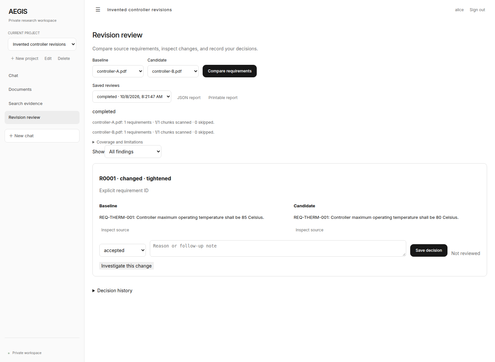

# AEGIS Showcase

A captioned, synthetic-document walkthrough of the AEGIS research experience.

The implementation repositories contain the parser, retrieval and validation details. This repository provides a shorter route through the user workflow: watch the demonstration, inspect its context, then follow the source links for implementation and limitations.

[Quick start](#quick-start) · [How it works](#how-it-works) · [Development](#development) · [Contributing](CONTRIBUTING.md)



[Watch the walkthrough](demo.mp4) · [Read the captions](captions.vtt)

## Quick start

Any static HTTP server is sufficient. Python is used below only as a convenient file server.

From a fresh checkout:

```bash
git clone https://github.com/ryash14/aegis-showcase.git
cd aegis-showcase
python3 -m http.server 8080
```

Open http://localhost:8080. This repository is a static demo; the retrieval and inference implementations live in the AEGIS project repositories. Synthetic demonstration results are not production benchmarks.

## How it works

1. Serve the static directory and open the walkthrough page.
2. Watch `demo.mp4` with the supplied WebVTT captions.
3. Use the implementation links to inspect how the demonstrated workflow is built.

### Design decisions

The page, video, preview and captions are static assets. There is no model endpoint, backend process or application database in this repository. The recorded material uses synthetic documents; it does not establish production adoption or a measured accuracy result.

## Implementation

**Stack:** HTML · CSS · browser video · WebVTT captions.

- [index.html](index.html)
- [captions.vtt](captions.vtt)

## Development

There is no complete automated verification command documented for this application. Start the affected component, use a small synthetic input and inspect its output before changing integrations. The contribution guide describes the evidence expected in a pull request.

## Contributing and support

Report reproducible bugs or propose changes through [GitHub Issues](https://github.com/ryash14/aegis-showcase/issues). Include the relevant environment and a small example rather than private datasets or credentials. See [contributing](CONTRIBUTING.md), [security reporting](SECURITY.md) and the [code of conduct](CODE_OF_CONDUCT.md).

## License

No repository-wide license is currently provided. Third-party components, models and datasets retain their own terms.
