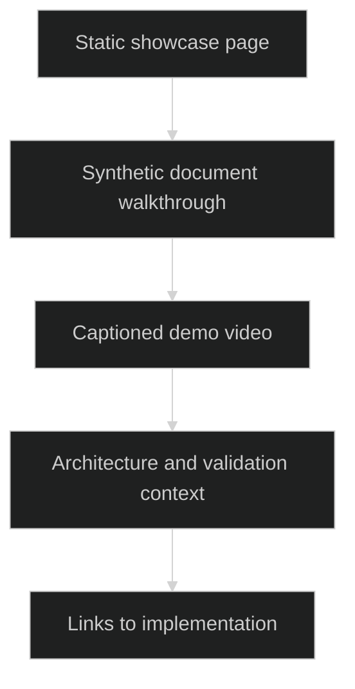

# AEGIS Showcase

> `A synthetic-document walkthrough of the AEGIS research and validation workflow.`

### 🏗️ System Architecture



### 🛠️ Production Stack

HTML · CSS · browser video · WebVTT captions

### ⚡ Key Engineering Capabilities

- A focused walkthrough communicates the research workflow.
- Bundled captions make the demo easier to follow.
- The showcase complements the implementation repositories rather than serving an inference API.

### 🚀 Deployment and Local Setup

Run from the repository root after cloning:

```bash
git clone https://github.com/ryash14/aegis-showcase.git
cd aegis-showcase
python3 -m http.server 8080
```

Open http://localhost:8080. This repository is a static demo; the retrieval and inference implementations live in the AEGIS project repositories. Synthetic demonstration results are not production benchmarks.

### Source Map

- [index.html](index.html)
- [captions.vtt](captions.vtt)
